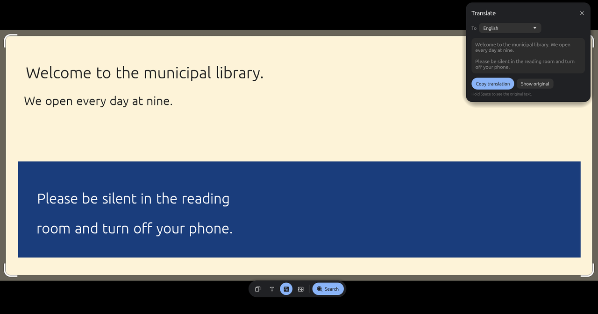
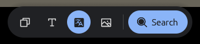
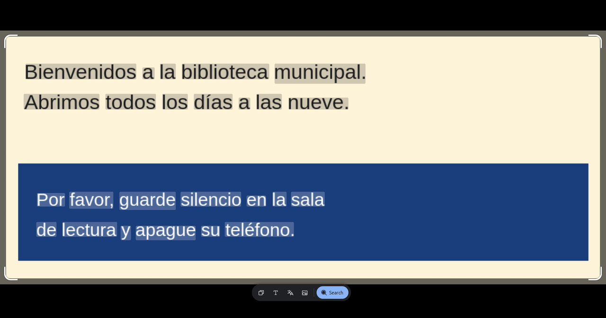

# rlens

**Google Lens for the Linux desktop, written in Rust.**
Press a key and the screen freezes under a colourful glow. Every word on the screen is
read and highlighted. You can copy it, translate it in place, decode QR codes, copy the
image, or search it with Google Lens in a side panel. It works on Hyprland, Sway, GNOME,
KDE and any X11 desktop.



<p align="center"></p>

## Features

| | |
|---|---|
| **Whole screen at once** | The shortcut selects the full screen and reads all of its text right away. Drag to narrow the selection. It gets rounded corner brackets, and the action bar follows it. |
| **Text** | Every detected word gets a soft highlight. Drag across words to select them, then **Copy**. **T** (text focus) dims the rest and shows only the words. |
| **Translate in place** | The original glyphs are erased from the background, and the translation is drawn in their place, line by line, in the original ink colour. There are no boxes, just like Lens. Hold **Space** to peek at the original. Translated words can be selected and copied too. |
| **Search with Google Lens** | Results open in a browser panel docked on the side away from your selection. Only the selected area is uploaded. |
| **QR / barcodes** | QR, EAN, UPC, Code 128, Data Matrix, PDF417, Aztec and more are decoded offline. Links open with one click. |
| **Copy image** | Copies the selected area to the clipboard as a PNG. |



## Works on every Linux desktop

| Desktop | Freeze-frame capture | Side panel placement |
|---|---|---|
| Hyprland, Sway, river, Wayfire, niri (wlroots) | `grim` | exact on Hyprland and Sway (IPC) |
| GNOME, KDE Plasma, other Wayland | xdg-desktop-portal Screenshot | the browser's requested size and position |
| Any X11 desktop (i3, XFCE, Cinnamon, MATE, …) | xcap | the browser's requested size and position |

`--backend auto` (the default) picks one backend and falls back to the next.

## Install

Runtime dependencies:

| Distro | Command |
|---|---|
| Arch | `sudo pacman -S tesseract tesseract-data-eng wl-clipboard grim xdg-desktop-portal chromium` |
| Debian / Ubuntu | `sudo apt install tesseract-ocr tesseract-ocr-eng wl-clipboard xclip grim xdg-desktop-portal chromium` |
| Fedora | `sudo dnf install tesseract tesseract-langpack-eng wl-clipboard xclip grim xdg-desktop-portal chromium` |

Any Chromium-family browser (Brave, Chrome, Edge, Vivaldi) works for the Lens panel.

**Other scripts:** install the Tesseract language pack for each script you want to read, for example
`sudo pacman -S tesseract-data-tam tesseract-data-hin tesseract-data-mal` (Debian/Ubuntu:
`tesseract-ocr-tam` …). With the default `[ocr] langs = "auto"`, rlens uses English plus up to
three installed packs. You can also set the list yourself, for example `langs = "eng+tam"`.

Build and install (Rust 1.88 or newer):

```sh
git clone https://github.com/Thejus-M/rlens && cd rlens
./install.sh            # ~/.local/bin/rlens + a .desktop entry
```

## Usage

```sh
rlens                         # overlay with the whole screen selected
rlens --ocr                   # drag an area, copy its text, notify
rlens --qr                    # drag an area, copy (and open) the first code
rlens --lens                  # drag an area, Google Lens in the side panel
rlens --file img.png          # use an image instead of the screen
rlens --clipboard             # use the image in the clipboard
rlens --area 100,80,640,360   # preselect an area (frame pixels)
rlens --backend portal        # force a capture backend: auto|wlroots|portal|x11
```

Keys in the overlay: **Esc** closes, **Ctrl+C** copies, **Space** (hold) shows the original text.
Exit code 1 means the user cancelled.

### Key binding examples

- **Hyprland (Lua config)**: `o.bind("SUPER + SHIFT + L", "Lens", "rlens")`
  and `o.window("^rlens$", { float = true, border_size = 0, rounding = 0 })`
- **Hyprland (hyprlang)**: `bind = SUPER SHIFT, L, exec, rlens`
- **Sway / i3**: `bindsym $mod+Shift+l exec rlens`
- **GNOME**: Settings → Keyboard → Custom Shortcuts → `rlens`
- **KDE**: System Settings → Shortcuts → Add New → Command → `rlens`

## Configuration

rlens writes `~/.config/rlens/config.toml` on first run:

```toml
[ocr]
langs = "eng"

[translate]
engine = "google"          # google | libretranslate | ollama
target = "en"
libretranslate_url = "https://libretranslate.com"
libretranslate_key = ""
ollama_model = "gemma4:e2b"

[ollama]                   # local vision model, off by default
enabled = false
url = "http://localhost:11434"
vision_model = "granite3.2-vision:2b"

[lens]
enabled = true
hl = "en"
browser = "auto"           # or a command such as "brave" or "chromium"

[ui]
select_all = true          # start with the whole screen selected
```

## How it works

- **Text** is read by Tesseract. Words are grouped into lines and paragraphs. A paragraph is split
  where the layout or the background changes, and noise such as icons and symbol strings is skipped.
- **Hard backgrounds** (video frames, glowing text, busy pictures): every OCR runs twice at the
  same time, on the image as it is and on a clean black-on-white version (Otsu threshold; dark
  images are inverted). The pass with more confident text wins. Lines are also split at wide
  gaps, so stray words on pictures do not join real sentences.
- **Translation** is one batched request for all paragraphs. When Google rate-limits the network
  (HTTP 429) and a local Ollama model is available (`[translate] ollama_model`), rlens falls back
  to it and says so.
- **Translation** runs per paragraph, so whole sentences keep their context. The result is then spread
  back over the original lines in proportion to their widths. The original glyphs are erased with a
  small inpainting step: a colour-distance mask, row-wise interpolation and a light blur. The
  translation is drawn in the sampled ink colour.
- **Search**: Google's result page only renders in a real browser, and it is tied to the session that
  uploaded the image. So rlens writes a small local page that posts the selection to Google Lens, and
  opens that page as a narrow app window of your Chromium-family browser. With your normal profile,
  your cookies keep captchas away.

## Privacy

Capture, OCR, barcode decoding, cropping and inpainting all run locally. Only two actions send data:

- **Search** sends the selected image to Google, from your browser.
- **Translate** (`google` or `libretranslate` engine) sends the recognised text.

The Google Lens upload and Google Translate endpoints are unofficial, and they can change.

## Roadmap

- **Click to select boxes.** After OCR, show subtle outlines around text blocks and paragraphs. One
  click selects a block as the new area, with no drag. Double-click selects a word, triple-click a line.
- **Object boxes.** Detect objects (products, faces, logos, plants) and offer them as clickable
  regions, Lens-style. Candidate: a tiny local detector such as Cactus Mirage (21 MB), run through its
  C API.
- Multi-monitor freeze frame (today: the focused monitor).
- Local translation (Ollama) and a local "what is this?" (vision model), both as one switch.
- More OCR scripts out of the box, with automatic language detection.
- Flatpak and AppImage packages.

## Development

```sh
cargo test                      # unit + fixture tests (needs tesseract)
cargo test -- --ignored         # live network / Ollama tests
RLENS_LOG=rlens=debug rlens     # verbose log
# debug builds can press a button themselves:
RLENS_DEBUG_ACTION=search|translate|translate-select|copyimage \
RLENS_DEBUG_TARGET=hi target/debug/rlens --file tests/fixtures/spanish.png --area 10,10,980,400
```

## Credits

- [Tesseract OCR](https://github.com/tesseract-ocr/tesseract) for text recognition
- [egui / eframe](https://github.com/emilk/egui) for the UI
- [rxing](https://github.com/rxing-core/rxing) for barcodes
- [Phosphor Icons](https://phosphoricons.com/) (MIT); the fonts are in `assets/fonts`, see `assets/fonts/LICENSE-phosphor`

## License

MIT. See [LICENSE](LICENSE).
